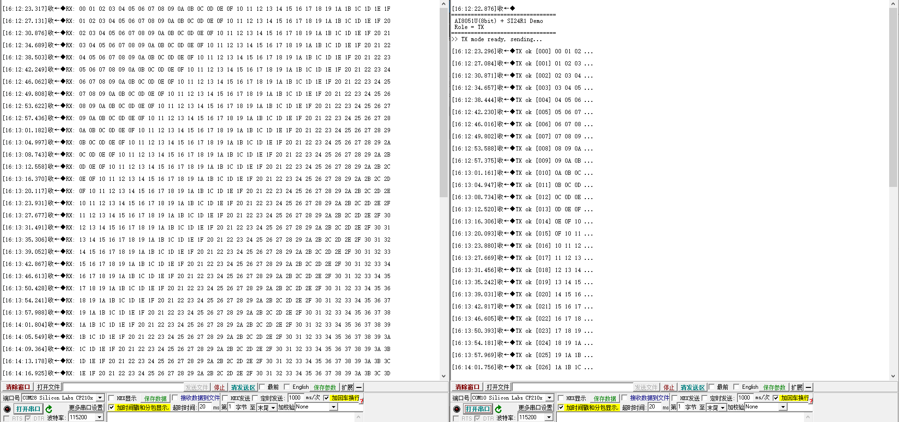
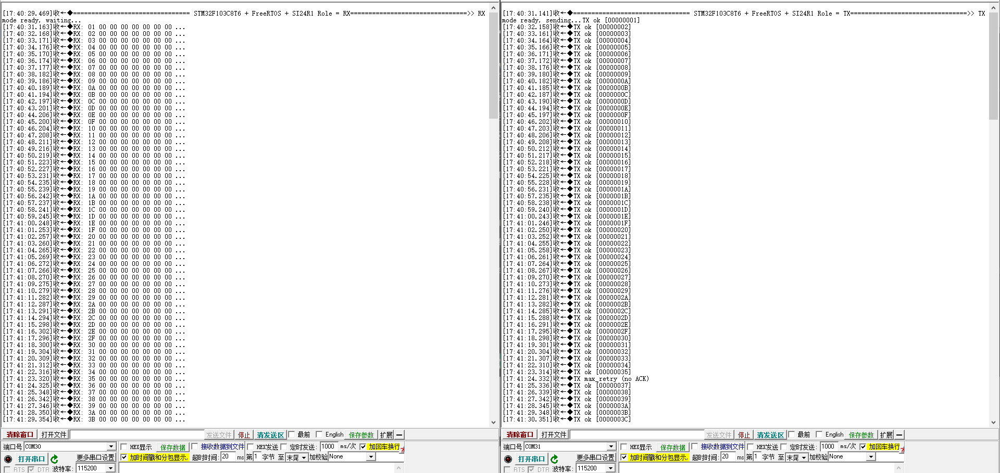

<div align="center">

# Ai-Thinker 2.4G Driver

</div>

[](README.zh-CN.md)

**Ai-Thinker 2.4G Driver** — driver and example firmware collection for the Ai-Thinker 2.4G module family, covering **4 chips** (SI24R1, BK2425, CI24R1, NRF24L01+) and **12 module models**. All firmware projects live under `firmware/`.

---

## 1. Repository Layout

All firmware projects live under `firmware/`, grouped by chip.

### NF-03, NF-01-S, NF-02-PA, NF-02-SM, NF-02-PE (SI24R1)

**Chip directory**: `firmware/si24r1/`

| Directory | MCU / Toolchain | Contents | Project file |
|-----------|-----------------|----------|--------------|
| `firmware/si24r1/stc15w408as-demo/` | STC15W408AS / Keil C51 | **Original factory demo** for the Ai-Thinker 2.4G test board: two boards control each other's LEDs via buttons | `USER/SI24R1.uvproj` |
| `firmware/si24r1/ai8051u-demo/` | AI8051U (8-bit) / Keil C51 | **Normal packet-link version** (baseline from the weekly-summary archive): UART logging, TX/RX self-test; no carrier test modes | `AI8051U-SI24R1.uvproj` |
| `firmware/si24r1/stm32f103c8t6-freertos/` | STM32F103C8T6 / MDK-ARM + FreeRTOS | Software-SPI driver with heartbeat and radio tasks | `Project.uvprojx` |
| `firmware/si24r1/stc15w408as-single-carrier/` | STC15W408AS / Keil C51 | **Single-carrier test demo** branched from the factory example: CW unmodulated carrier and continuous modulated TX (defaults to MOD) | `USER/SI24R1.uvproj` |
| `firmware/si24r1/ai8051u-single-carrier/` | AI8051U (8-bit) / Keil C51 | AI8051U port of the same single-carrier test framework; `SI24R1_TEST_MODE` = 0 / 1 / 2 (defaults to 0, normal link) | `AI8051U-SI24R1.uvproj` |

**Test captures** — both are SI24R1 packet-link runs, captured from two serial terminals (one TX, one RX) at 115200-8-N-1.

`firmware/si24r1/ai8051u-demo/` — AI8051U, 32-byte incremental payload



`firmware/si24r1/stm32f103c8t6-freertos/` — STM32F103C8T6 + FreeRTOS, `SI24R1_ROLE = RX`



### NF-04, NF-04-MI (BK2425)

**Chip directory**: `firmware/bk2425/`

| Directory | MCU / Toolchain | Contents | Project file |
|-----------|-----------------|----------|--------------|
| `firmware/bk2425/stc15w408as-demo/` | STC15W408AS / Keil C51 | BK2425 factory STC15 example (software-SPI driver, button/LED demo) | `USER/BK2425.uvproj` |

### NF-05, NF-05-S (CI24R1)

**Chip directory**: `firmware/ci24r1/`

| Directory | MCU / Toolchain | Contents | Project file |
|-----------|-----------------|----------|--------------|
| `firmware/ci24r1/stc15w408as-demo/` | STC15W408AS / Keil C51 | CI24R1 factory STC15 example (software-SPI driver, button/LED demo) | `USER/CI24R1.uvproj` |

### NF-01-N, NF-02-PA, NF-02-PE (NRF24L01+)

**Chip directory**: `firmware/nrf24l01p/`

| Directory | MCU / Toolchain | Contents | Project file |
|-----------|-----------------|----------|--------------|
| `firmware/nrf24l01p/stc15w408as-demo/` | STC15W408AS / Keil C51 | NRF24L01+ factory STC15 example (software-SPI driver, button/LED demo) | `USER/nRF24L01P.uvproj` |

---

## 2. Pin Mapping

Pin mapping below uses `NF-02-PA(SI24R1)` as the reference module (SI24R1 based, nRF24L01+ compatible, up to **+7 dBm** TX power).

| NF-02-PA(SI24R1) | STC15W408AS | AI8051U | STM32F103C8T6 |
|--------------------|-------------|---------|---------------|
| CE     | P1.4        | P1.4    | PA11 (CTR1) |
| CSN    | P1.5        | P1.5    | PA4 (SPI_NSS) |
| SCK    | P1.2        | P1.2    | PA5 (SPI_SCK) |
| MOSI   | P1.3        | P1.3    | PA7 (SPI_MOSI) |
| MISO   | P1.0        | P1.0    | PA6 (SPI_MISO) |
| IRQ    | P1.1        | P1.1    | PB0 (LORA_DIO0) |

- Debug UART: AI8051U = P3.7 (TX) / P3.6 (RX); STM32 = PA9 (TX) / PA10 (RX); both 115200-8-N-1.
- Full port-mode configuration: `docs/wiring.zh-CN.md`.

---

## 3. RF Parameters

| Project | RF_CH | Frequency | Rate / Power (`RF_SETUP`) | Auto retransmit | CRC |
|---------|-------|-----------|---------------------------|-----------------|-----|
| `firmware/si24r1/stc15w408as-demo/` | 40 | 2440 MHz | 2 Mbps / +7 dBm (`0x0F`) | 250us+86us x10 (`0x0A`) | 16 bit |
| `firmware/si24r1/ai8051u-demo/` | 40 | 2440 MHz | 1 Mbps / +7 dBm (`0x07`) | 500us x10 (`0x1A`) | 16 bit |
| `firmware/si24r1/stm32f103c8t6-freertos/` | 100 | 2500 MHz | 1 Mbps / +7 dBm (`0x07`) | 500us x15 (`0x1F`) | 16 bit |
| `firmware/si24r1/ai8051u-single-carrier/` (`TEST_MODE=0`) | 100 | 2500 MHz | 1 Mbps / +7 dBm (`0x07`) | 500us x15 (`0x1F`) | 16 bit |
| `firmware/si24r1/*-single-carrier/` (`TEST_MODE=1/2`) | 75 | 2475 MHz | 2 Mbps / +7 dBm (`0x0F`; CW adds `CONT_WAVE+PLL_LOCK` -> `0x9F`) | disabled | 16 bit |

Common settings: address `0A 01 07 0E 01` (5 bytes), 32-byte payload, auto-ACK on pipe 0, 16-bit CRC.

---

## 4. Single-Carrier Test Modes (CW / MOD)

- `firmware/si24r1/ai8051u-single-carrier/Source/SI24R1.h` — `SI24R1_TEST_MODE` defaults to **0** (normal packet link)
- `firmware/si24r1/stc15w408as-single-carrier/SI24R1/SI24R1.h` — `SI24R1_TEST_MODE` defaults to **2** (continuous modulated TX)

```c
#define SI24R1_TEST_MODE  0   // 0 = normal packet link
                              // 1 = CW  : unmodulated carrier, for power / frequency tolerance / spurious
                              // 2 = MOD : continuous modulated TX, for OBW / 6 dB BW / PSD
```

| Mode | Sequence | RF_SETUP | Purpose |
|------|----------|----------|---------|
| 1 CW | `CONFIG=0x0E` -> wait >=1.5 ms -> `CONT_WAVE+PLL_LOCK` -> set RF_CH -> hold CE high | `0x9F` | Single spectral line; OBW is only tens of kHz |
| 2 MOD | Clear EN_AA / SETUP_RETR, hold CE high, keep feeding pseudo-random payloads into TX FIFO | `0x0F` | A genuinely continuous modulated carrier |

- Calling `SI24R1_TxPacket()` per packet produces an on/off burst train that a swept spectrum analyser cannot measure correctly — use mode 2.

---

## 5. Building and Flashing

| Project | Environment | Steps |
|---------|-------------|-------|
| STC15 projects (SI24R1 / BK2425 / NRF24L01+) | Keil C51 | Open the matching `USER/*.uvproj` (`SI24R1.uvproj` / `BK2425.uvproj` / `nRF24L01P.uvproj`), Device = STC15W408AS, internal IRC 22.1184 MHz; flash with STC-ISP |
| STC15 project (CI24R1) | Keil C51 | Open `USER/CI24R1.uvproj`, internal IRC **11.0592 MHz** (different from the other three), cold-start when downloading; flash with STC-ISP |
| AI8051U projects | Keil C51 | Run `build.bat` or open `.uvproj`; clock 33.1776 MHz; 8-bit mode |
| STM32 project | Keil MDK + `Keil.STM32F1xx_DFP` | Open `Project.uvprojx`, Define includes `STM32F10X_MD,USE_STDPERIPH_DRIVER`; flash `Objects/Project.axf` with ST-Link |

- AI8051U projects default to TX: set `SI24R1_ROLE` to `SI24R1_ROLE_RX` in `SI24R1.h` to build the receiver firmware (or override via a preprocessor define).
- `firmware/si24r1/ai8051u-single-carrier/` defaults to `SI24R1_TEST_MODE = 0`; set it to 1 (CW) or 2 (MOD) before building a carrier test. `firmware/si24r1/stc15w408as-single-carrier/` already defaults to MOD.
- STM32 defaults to RX: change `SI24R1_ROLE` in `Hardware/SI24R1/SI24R1.h`; one board must transmit, the other receive. No fromelf post-build step is configured, so the build produces only `.axf`; enable one under Options for Target -> User -> After Build if a `.hex` file is needed.
