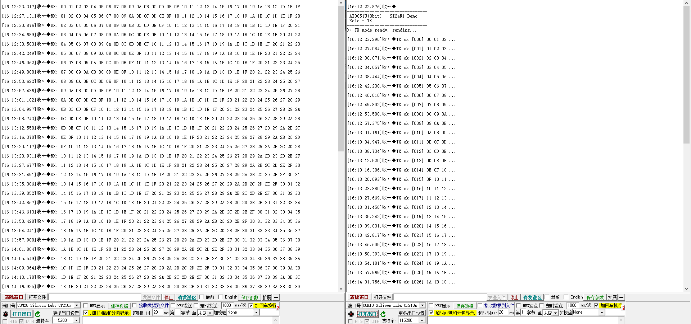
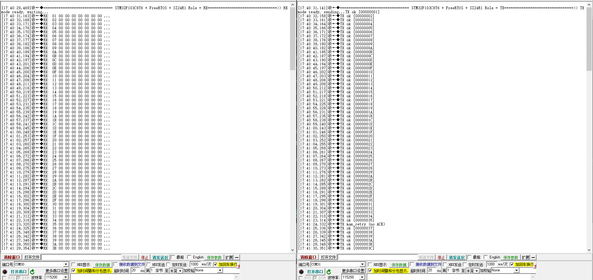
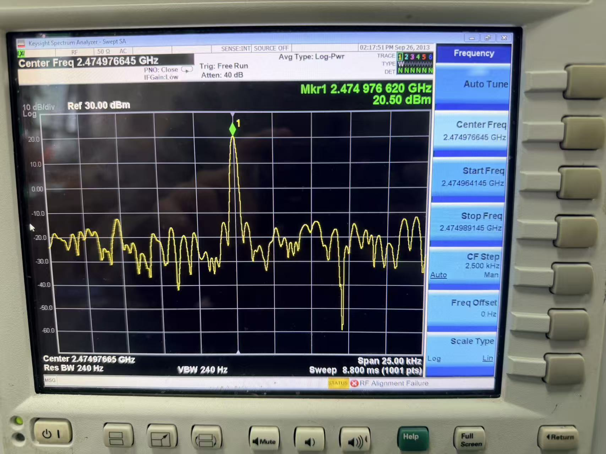
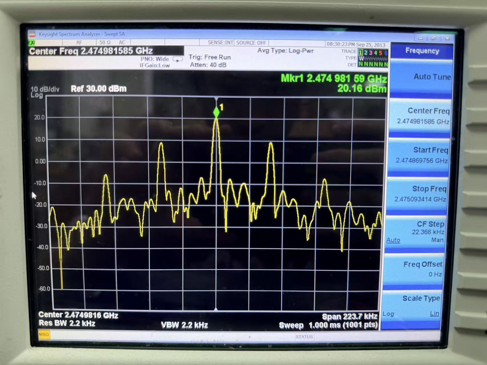

<div align="center">

# Ai-Thinker 2.4G Driver

</div>

[](README.md)

**Ai-Thinker 2.4G Driver** —— 安信可 2.4G 系列模组的驱动与示例固件集合。覆盖 **4 颗芯片**（SI24R1、BK2425、CI24R1、NRF24L01+）与 **12 个模组型号**，每个芯片一个目录，直接放在仓库根目录。

> 官方资料：安信可 2.4G 系列模组文档 <https://docs.ai-thinker.com/2.4g_1/>

---

## 1. 仓库结构

固件工程按芯片分目录，直接放在仓库根目录。

### NF-03、NF-01-S、NF-02-PA、NF-02-SM、NF-02-PE(SI24R1)

**芯片目录**：[`SI24R1/`](SI24R1/)

| 目录 | MCU / 工具链 | 内容 | 工程文件 |
|------|--------------|------|----------|
| [`STC15W408AS-Demo`](SI24R1/STC15W408AS-Demo/) | STC15W408AS / Keil C51 | 安信可 2.4G 测试板**原厂默认示例**：双板按键互控 LED | `USER/SI24R1.uvproj` |
| [`AI8051U-Demo`](SI24R1/AI8051U-Demo/) | AI8051U（8-bit）/ Keil C51 | **正常收发链路版**（取自周总结归档基线）：串口日志、TX/RX 自测；不含载波测试模式 | `AI8051U-SI24R1.uvproj` |
| [`STM32F103C8T6-FreeRTOS-Demo`](SI24R1/STM32F103C8T6-FreeRTOS-Demo/) | STM32F103C8T6 / MDK-ARM + FreeRTOS | 软件 SPI 驱动 + 心跳任务 / 无线任务 | `Project.uvprojx` |
| [`STM32F103C8T6-FreeRTOS-Single-Carrier`](SI24R1/STM32F103C8T6-FreeRTOS-Single-Carrier/) | STM32F103C8T6 / Keil ARM-GNU（arm-none-eabi-gcc）+ FreeRTOS | 由上一工程复制的**单载波（CW）测试固件**：上电即进入 2475 MHz 连续未调制载波（`RF_SETUP = 0x9F`），CE 常高，心跳任务照常运行；只有串口启动横幅，不含收发链路 | `Project.uvprojx` |
| [`STC15W408AS-Single-Carrier`](SI24R1/STC15W408AS-Single-Carrier/) | STC15W408AS / Keil C51 | 从原厂示例派生的**单载波测试 demo**：未调制单载波 CW、连续调制发射 MOD（默认 MOD） | `USER/SI24R1.uvproj` |
| [`AI8051U-Single-Carrier`](SI24R1/AI8051U-Single-Carrier/) | AI8051U（8-bit）/ Keil C51 | 同一套单载波测试框架在 AI8051U 上的移植；`SI24R1_TEST_MODE` = 0 / 1 / 2（默认 1，CW） | `AI8051U-SI24R1.uvproj` |

**实测截图** —— 下面两张均为 SI24R1 工程的双板收发串口日志（一发一收，115200-8-N-1）。

**[`AI8051U-Demo`](SI24R1/AI8051U-Demo/)** — AI8051U，32 字节递增载荷



**[`STM32F103C8T6-FreeRTOS-Demo`](SI24R1/STM32F103C8T6-FreeRTOS-Demo/)** — STM32F103C8T6 + FreeRTOS（`SI24R1_ROLE = RX`）



**[`STM32F103C8T6-FreeRTOS-Single-Carrier`](SI24R1/STM32F103C8T6-FreeRTOS-Single-Carrier/)** 只在 USART1 打印一次启动横幅（`CW mode: carrier on, forever` / `RF = 2475 MHz, RF_SETUP = 0x9F`），随后持续输出载波，没有可截图的收发日志，请在频谱仪上验证。

**频谱实测** —— Keysight 扫频式频谱仪窄带扫频（Ref 30 dBm、10 dB/div、衰减 40 dB），均围绕 2475 MHz 载波。

**[`STM32F103C8T6-FreeRTOS-Single-Carrier`](SI24R1/STM32F103C8T6-FreeRTOS-Single-Carrier/)** — 中心 2.47498 GHz、Span 25 kHz、RBW/VBW 240 Hz；标记 `Mkr1 2.474976620 GHz` 读数为 **20.50 dBm**。只有单根谱线，是未调制载波，占用带宽仅几十 kHz。



**[`AI8051U-Single-Carrier`](SI24R1/AI8051U-Single-Carrier/)** — 中心 2.47498 GHz、Span 223.7 kHz、RBW/VBW 2.2 kHz（`PNO Wide`）；标记读数 **20.16 dBm**。除主谱线外还有若干离散旁线，因此这条曲线**不是**干净的单载波，作为 CW 参考前先确认板子上的 `SI24R1_TEST_MODE`。



> 第一张截图的状态栏带 `RF Alignment Failure` 告警，绝对功率读数只能作定性参考。

### NF-04、NF-04-MI(BK2425)

**芯片目录**：[`BK2425/`](BK2425/)

| 目录 | MCU / 工具链 | 内容 | 工程文件 |
|------|--------------|------|----------|
| [`STC15W408AS-Demo`](BK2425/STC15W408AS-Demo/) | STC15W408AS / Keil C51 | BK2425 原厂 STC15 示例（软件 SPI 驱动、按键控灯） | `USER/BK2425.uvproj` |

### NF-05、NF-05-S(CI24R1)

**芯片目录**：[`CI24R1/`](CI24R1/)

| 目录 | MCU / 工具链 | 内容 | 工程文件 |
|------|--------------|------|----------|
| [`STC15W408AS-Demo`](CI24R1/STC15W408AS-Demo/) | STC15W408AS / Keil C51 | CI24R1 原厂 STC15 示例（软件 SPI 驱动、按键控灯） | `USER/CI24R1.uvproj` |

### NF-01-N、NF-02-PA、NF-02-PE(NRF24L01+)

**芯片目录**：[`NRF24L01P/`](NRF24L01P/)

| 目录 | MCU / 工具链 | 内容 | 工程文件 |
|------|--------------|------|----------|
| [`STC15W408AS-Demo`](NRF24L01P/STC15W408AS-Demo/) | STC15W408AS / Keil C51 | NRF24L01+ 原厂 STC15 示例（软件 SPI 驱动、按键控灯） | `USER/nRF24L01P.uvproj` |

---

## 2. 引脚对照

以下以 `NF-02-PA(SI24R1)` 模组为参考（基于 SI24R1 芯片，兼容 nRF24L01+，最大发射功率 **+7 dBm**）。

| NF-02-PA(SI24R1) | STC15W408AS | AI8051U | STM32F103C8T6 |
|--------------------|-------------|---------|-------------------------------|
| CE     | P1.4        | P1.4    | PA11（CTR1） |
| CSN    | P1.5        | P1.5    | PA4（SPI_NSS） |
| SCK    | P1.2        | P1.2    | PA5（SPI_SCK） |
| MOSI   | P1.3        | P1.3    | PA7（SPI_MOSI） |
| MISO   | P1.0        | P1.0    | PA6（SPI_MISO） |
| IRQ    | P1.1        | P1.1    | PB0（LORA_DIO0） |

- 两个 STM32 工程（[`STM32F103C8T6-FreeRTOS-Demo`](SI24R1/STM32F103C8T6-FreeRTOS-Demo/) 与 [`STM32F103C8T6-FreeRTOS-Single-Carrier`](SI24R1/STM32F103C8T6-FreeRTOS-Single-Carrier/)）共用上表接线，只是固件行为不同。
- 调试串口：AI8051U = P3.7(TX)/P3.6(RX)，STM32 = PA9(TX)/PA10(RX)，均 115200-8-N-1。
- 完整端口模式配置见 [`Docs/wiring.zh-CN.md`](Docs/wiring.zh-CN.md)。

---

## 3. 射频参数

| 工程 | RF_CH | 频率 | 速率 / 功率（`RF_SETUP`） | 自动重发 | CRC |
|------|-------|------|---------------------------|----------|-----|
| [`STC15W408AS-Demo`](SI24R1/STC15W408AS-Demo/) | 40 | 2440 MHz | 2 Mbps / +7 dBm (`0x0F`) | 250us+86us ×10 (`0x0A`) | 16 bit |
| [`AI8051U-Demo`](SI24R1/AI8051U-Demo/) | 40 | 2440 MHz | 1 Mbps / +7 dBm (`0x07`) | 500us ×10 (`0x1A`) | 16 bit |
| [`STM32F103C8T6-FreeRTOS-Demo`](SI24R1/STM32F103C8T6-FreeRTOS-Demo/) | 100 | 2500 MHz | 1 Mbps / +7 dBm (`0x07`) | 500us ×15 (`0x1F`) | 16 bit |
| [`STM32F103C8T6-FreeRTOS-Single-Carrier`](SI24R1/STM32F103C8T6-FreeRTOS-Single-Carrier/) | 75 | 2475 MHz | 2 Mbps / +7 dBm CW (`0x9F`) | 关闭 | 16 bit |
| [`AI8051U-Single-Carrier`](SI24R1/AI8051U-Single-Carrier/)（`TEST_MODE=0`） | 100 | 2500 MHz | 1 Mbps / +7 dBm (`0x07`) | 500us ×15 (`0x1F`) | 16 bit |
| `*-Single-Carrier`（`TEST_MODE=1/2`，仅 8-bit 工程） | 75 | 2475 MHz | 2 Mbps / +7 dBm (`0x0F`；CW 再加 `CONT_WAVE+PLL_LOCK` → `0x9F`) | 关闭 | 16 bit |

公共配置：地址 `0x0A 0x01 0x07 0x0E 0x01`（5 字节）、Payload 32 字节、通道 0 自动应答、16 位 CRC。

---

## 4. 单载波测试模式（CW / 连续调制 MOD）

- [`AI8051U-Single-Carrier/Source/SI24R1.h`](SI24R1/AI8051U-Single-Carrier/Source/SI24R1.h) — `SI24R1_TEST_MODE` 默认为 **1**（CW）
- [`STC15W408AS-Single-Carrier/SI24R1/SI24R1.h`](SI24R1/STC15W408AS-Single-Carrier/SI24R1/SI24R1.h) — `SI24R1_TEST_MODE` 默认为 **2**（连续调制发射）
- [`STM32F103C8T6-FreeRTOS-Single-Carrier`](SI24R1/STM32F103C8T6-FreeRTOS-Single-Carrier/) — 没有模式开关，是**纯 CW 固件**（`main.c` 只调用一次 `SI24R1_CW_Mode()`，随后任务空转）。载波由 [`Hardware/SI24R1/SI24R1.h`](SI24R1/STM32F103C8T6-FreeRTOS-Single-Carrier/Hardware/SI24R1/SI24R1.h) 中的 `RF_CH_CW`（75 → 2475 MHz）与 `RF_SETUP_CW`（`0x9F`）决定，改这两个宏即可换信道/功率；需要 MOD 时把 AI8051U 工程里持续喂 TX FIFO 伪随机载荷的循环搬过来，并清 `EN_AA` / `SETUP_RETR`。

```c
#define SI24R1_TEST_MODE  0   // 0 = 正常收发链路
                              // 1 = CW  未调制单载波：载波功率 / 频率容限 / 杂散
                              // 2 = MOD 连续调制发射：占用带宽 / 6dB 带宽 / PSD
```

| 模式 | 做法 | RF_SETUP | 用途 |
|------|------|----------|------|
| 1 CW | `CONFIG=0x0E` → 延时 ≥1.5 ms → `CONT_WAVE+PLL_LOCK` → 设 RF_CH → CE 常高 | `0x9F` | 单根谱线，OBW 仅几十 kHz |
| 2 MOD | EN_AA / SETUP_RETR 清零、CE 常高、持续向 TX FIFO 喂伪随机载荷 | `0x0F` | 真正的连续调制载波 |

- 逐包调用 `SI24R1_TxPacket()` 会产生通断突发，扫频式频谱仪测不准，必须用模式 2。

---

## 5. 编译与烧录

| 工程 | 环境 | 步骤 |
|------|------|------|
| STC15 工程（SI24R1 / BK2425 / NRF24L01+） | Keil C51 | 打开对应 `USER/*.uvproj`（`SI24R1.uvproj` / `BK2425.uvproj` / `nRF24L01P.uvproj`），Device = STC15W408AS，内部 IRC 22.1184 MHz；STC-ISP 烧录 |
| STC15 工程（CI24R1） | Keil C51 | 打开 `USER/CI24R1.uvproj`，内部 IRC **11.0592 MHz**（与其余三颗不同），下载需冷启动；STC-ISP 烧录 |
| AI8051U 工程 | Keil C51 | 运行 `build.bat` 或打开 `.uvproj`；主频 33.1776 MHz；8bit 模式 |
| [`STM32F103C8T6-FreeRTOS-Demo`](SI24R1/STM32F103C8T6-FreeRTOS-Demo/) | Keil MDK + `Keil.STM32F1xx_DFP` | 打开 `Project.uvprojx`，Define 含 `STM32F10X_MD,USE_STDPERIPH_DRIVER`；ST-Link 烧录 `Objects/Project.axf` |
| [`STM32F103C8T6-FreeRTOS-Single-Carrier`](SI24R1/STM32F103C8T6-FreeRTOS-Single-Carrier/) | Keil MDK + **ARM-GNU**（arm-none-eabi-gcc）工具链 | 打开 `Project.uvprojx`；启动文件为 [`gcc/startup_stm32f103xb.s`](SI24R1/STM32F103C8T6-FreeRTOS-Single-Carrier/gcc/startup_stm32f103xb.s)，链接脚本为 [`gcc/stm32f103c8.ld`](SI24R1/STM32F103C8T6-FreeRTOS-Single-Carrier/gcc/stm32f103c8.ld)，[`gcc/syscalls.c`](SI24R1/STM32F103C8T6-FreeRTOS-Single-Carrier/gcc/syscalls.c) 提供 newlib 桩函数；`CreateHexFile=1`，会同时输出 `Project.hex` |

- AI8051U 工程默认角色均为 TX：改 `SI24R1.h` 中 `SI24R1_ROLE` 为 `SI24R1_ROLE_RX` 编出接收端固件（或用编译预定义覆盖）。
- [`AI8051U-Single-Carrier`](SI24R1/AI8051U-Single-Carrier/) 默认 `SI24R1_TEST_MODE = 1`（CW），要跑正常链路改成 0、要连续调制改成 2；[`STC15W408AS-Single-Carrier`](SI24R1/STC15W408AS-Single-Carrier/) 默认即为 MOD。
- STM32 默认角色 RX：改 [`Hardware/SI24R1/SI24R1.h`](SI24R1/STM32F103C8T6-FreeRTOS-Demo/Hardware/SI24R1/SI24R1.h) 中 `SI24R1_ROLE`；两块板必须一发一收。收发工程未配置 fromelf 后处理，编译只生成 `.axf`，需要 `.hex` 时请在 Options for Target → User → After Build 中自行启用。
- STM32 单载波工程运行时不读 `SI24R1_ROLE`（它从不进入 RX/TX 收发包流程），FreeRTOS 堆改为 `12 * 1024`（原工程 17 KB）；`configCHECK_HANDLER_INSTALLATION` 显式设为 `0`，因为该固件尚未在硬件上回归验证，若重新打开需同时定义 `configASSERT()`。
