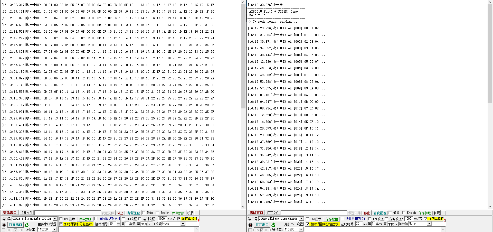

# NF-02-PA (SI24R1) on AI8051U — Normal Transceiver Link

[](README.zh-CN.md)

> Official documentation: <https://docs.ai-thinker.com/2.4g_1/>

SI24R1 transceiver example on AI8051U (taken from the weekly-summary baseline): UART logging plus TX/RX self-test, without the carrier test modes.

- Chip: SI24R1 (software SPI, nRF24L01+ compatible)
- MCU: AI8051U, 32-bit mode (C351 compiler, 8-bit core configuration `STC51U_8BIT`)
- Clock **33.1776 MHz**, UART1 = 115200-8-N-1

---

## 1. Layout

```
AI8051U-Demo/
├── Source/
│   ├── main.c                # init, UART logging, TX/RX task loop
│   ├── main_full.c           # full reference version kept during cleanup, not built
│   ├── SI24R1.c / SI24R1.h   # driver + pin macros + role macro
│   └── XSFR_STC8051U_8Bit.H  # AI8051U register / port definitions
├── Toolchain/                # local Keil C51 cache (no binaries in CI)
├── AI8051U-SI24R1.uvproj     # Keil C51 project
├── build.bat                 # command-line build script
└── README.md
```

## 2. Pins

| SI24R1 signal | AI8051U |
|---------------|---------|
| CE   | P1.4 |
| CSN  | P1.5 |
| SCK  | P1.2 |
| MOSI | P1.3 |
| MISO | P1.0 |
| IRQ  | P1.1 |

- Debug UART: P3.7 (TX) / P3.6 (RX), 115200-8-N-1.
- Status LED: `P2^0` (active low, see `sbit LED` in `main.c`).
- Same pin order as the STC15 version, so the wiring in [`Docs/wiring.md`](../../Docs/wiring.md) can be reused directly.

## 3. Role configuration

`SI24R1_ROLE` in `Source/SI24R1.h` defaults to **TX**:

```c
#define SI24R1_ROLE  SI24R1_ROLE_TX   // transmitter
// #define SI24R1_ROLE  SI24R1_ROLE_RX // receiver
```

It can also be overridden with the compile defines `-DSI24R1_ROLE=0` (RX) / `=1` (TX). **One board must transmit and the other receive**, with matching addresses.

## 4. RF settings

| Item | Value |
|------|-------|
| Channel | `RF_CH = 40` → 2440 MHz |
| Rate / power | 1 Mbps / +7 dBm (`RF_SETUP = 0x07`) |
| Auto retransmit | 500 us × 10 (`SETUP_RETR = 0x1A`) |
| Payload | 32-byte incremental payload, 5-byte address |
| CRC | 16 bit |

## 5. Build and flash

- Double-click `build.bat` (calls `UV4.exe -b AI8051U-SI24R1.uvproj`, output `Objects/AI8051U-SI24R1.Hex`), or open `AI8051U-SI24R1.uvproj` in Keil C51 and Rebuild.
- Download the HEX with STC-ISP; AI8051U needs a cold start / power cycle as prompted.
- The measured two-board log is also shown in the repository root [`README.md`](../../README.md).

## 6. Measured log

Two AI8051U boards (one TX, one RX, built with different `SI24R1_ROLE`) run the same firmware; the UART at 115200-8-N-1 prints TX/RX counters for the 32-byte incremental payload, and both counters grow together.



## 7. Notes

This project does not provide CW / MOD test modes; for certification testing use [`../AI8051U-Single-Carrier/`](../AI8051U-Single-Carrier/).
