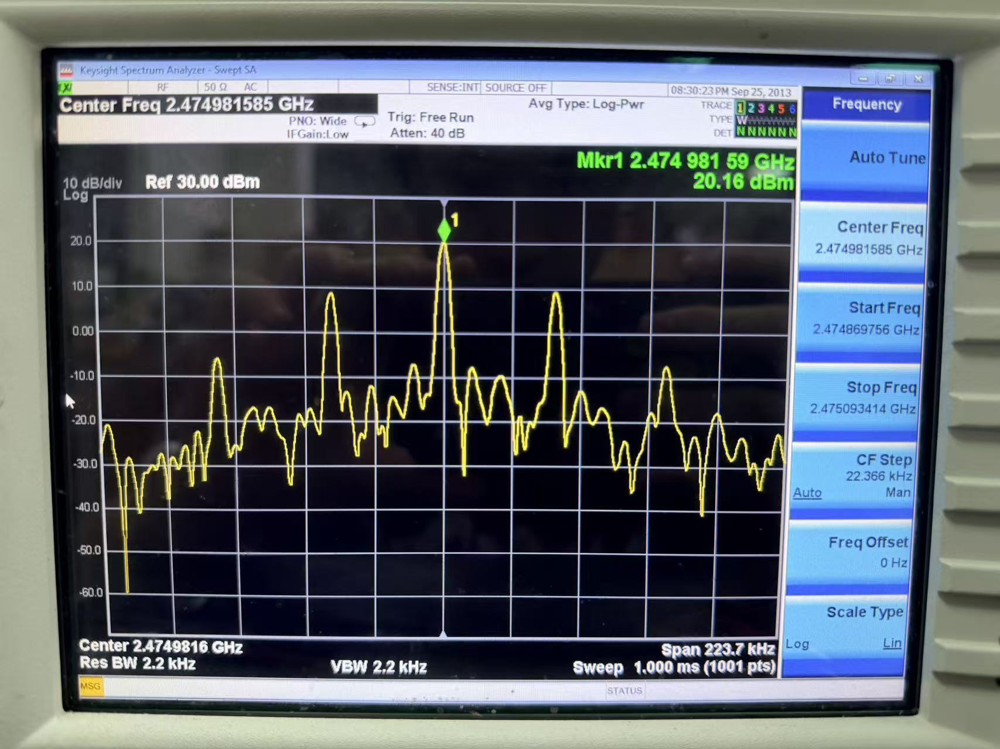

# NF-02-PA (SI24R1) on AI8051U — Single-Carrier / Continuous Modulation Test

[](README.zh-CN.md)

> Official documentation: <https://docs.ai-thinker.com/2.4g_1/>

The STC15 single-carrier test framework ported to AI8051U, using `SI24R1_TEST_MODE` to switch between "normal link / CW / MOD".

- Chip: SI24R1 (software SPI, nRF24L01+ compatible)
- MCU: AI8051U, 32-bit mode (C351), **33.1776 MHz**, UART1 115200-8-N-1

---

## 1. Layout

```
AI8051U-Single-Carrier/
├── Source/
│   ├── main.c                # mode branch entry (CW / MOD / normal link)
│   ├── main_full.c           # full reference version, not built
│   ├── SI24R1.c / SI24R1.h   # driver + pins + SI24R1_TEST_MODE
│   └── XSFR_STC8051U_8Bit.H  # AI8051U register / port definitions
├── Toolchain/                # local Keil C51 cache (no binaries in CI)
├── AI8051U-SI24R1.uvproj     # Keil C51 project
├── build.bat                 # command-line build script
├── keilkill.bat              # removes build intermediates
└── README.md
```

## 2. Test modes

`SI24R1_TEST_MODE` in `Source/SI24R1.h` **currently defaults to 1 (CW)**:

```c
#define SI24R1_TEST_MODE  1   // 0 = normal link
                              // 1 = CW  unmodulated carrier (current default)
                              // 2 = MOD continuous modulated TX
```

| Mode | Parameters | Purpose |
|------|------------|---------|
| 0 | `RF_CH = 100` / 2500 MHz, 1 Mbps, +7 dBm (`0x07`) | normal link, behaves like `AI8051U-Demo` |
| 1 | `RF_CH = 75` / 2475 MHz, 2 Mbps, +7 dBm, `RF_SETUP = 0x9F` | carrier power, frequency tolerance, spurious |
| 2 | same channel/rate, `RF_SETUP = 0x0F`, auto-ACK cleared, TX FIFO fed continuously | occupied bandwidth, 6 dB bandwidth, PSD |

- The "0 is default" note in the file header is the original comment; the actual value is the `#define SI24R1_TEST_MODE` line, so confirm it before emitting a carrier.
- OBW must be measured in mode 2: per-packet transmission is an on/off burst that a swept analyser measures incorrectly.

## 3. Pins

| SI24R1 signal | AI8051U |
|---------------|---------|
| CE   | P1.4 |
| CSN  | P1.5 |
| SCK  | P1.2 |
| MOSI | P1.3 |
| MISO | P1.0 |
| IRQ  | P1.1 |

- Debug UART: P3.7 (TX) / P3.6 (RX), 115200-8-N-1.
- Status LED: `P2^0` (active low).
- The role macro `SI24R1_ROLE` defaults to **TX** and only applies in mode 0; the two boards must be set to opposite roles.

## 4. Build and flash

1. Set `SI24R1_TEST_MODE` as needed.
2. Double-click `build.bat` (output `Objects/AI8051U-SI24R1.Hex`), or open `AI8051U-SI24R1.uvproj` in Keil C51.
3. Download with STC-ISP; AI8051U needs a cold start as prompted.
4. Modes 1/2 transmit immediately at power-up; switch back to 0 or power down after measuring.

## 5. Spectrum measurement (narrow-span sweep)

Keysight swept spectrum analyser, Ref 30 dBm / 10 dB/div / 40 dB attenuation, centre 2.47498 GHz, span 223.7 kHz, RBW = VBW = 2.2 kHz (PNO Wide), marker `Mkr1 2.47498159 GHz` reads **20.16 dBm**.



- Besides the 2475 MHz main line there are several discrete side lines, so what was captured is not a pure single carrier; confirm the flashed firmware really has `SI24R1_TEST_MODE = 1` before using this as a CW reference.
- A swept analyser can only show the narrow-band shape qualitatively; occupied bandwidth (the ≥500 kHz criterion) must be measured in mode 2 with a wide span or a dedicated OBW function.

## 6. Notes

Mode 0 UART logs and screenshots are in [`../AI8051U-Demo/`](../AI8051U-Demo/); the two projects share pins and driver and can be swapped freely.
