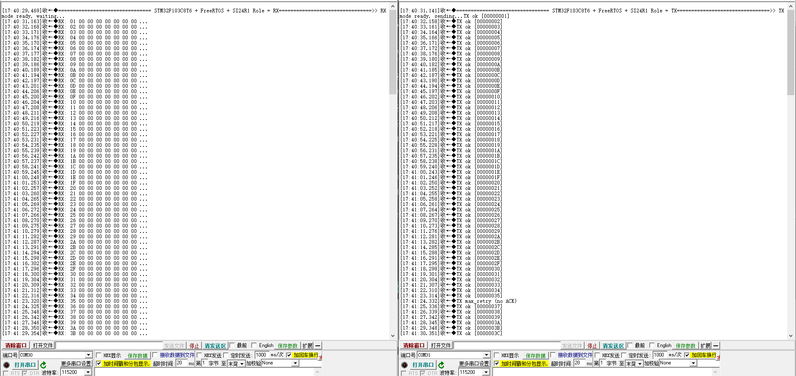

# NF-02-PA (SI24R1) on STM32F103C8T6 + FreeRTOS

[](README.zh-CN.md)

> Official documentation: <https://docs.ai-thinker.com/2.4g_1/>

A port of the **NF-02-PA (SI24R1, a 2.4 GHz module based on the SI24R1 chip and compatible with nRF24L01+) driver to STM32F103C8T6 + FreeRTOS**.

---

## 1. Layout

```
SI24R1/STM32F103C8T6-FreeRTOS-Demo/
├── Project.uvprojx          # Keil project
├── Start/                   # startup files (core_cm3 / system_stm32f10x / stm32f10x.h)
├── Library/                 # STM32F10x standard peripheral library
├── System/                  # Delay (SysTick based)
├── Hardware/
│   ├── LED.c / LED.h        # LED1=PC13 (on board), LED2=PA8
│   └── SI24R1/              # ★ ported SI24R1 driver (software SPI)
│       ├── SI24R1.h
│       └── SI24R1.c
├── User/
│   ├── main.c               # ★ FreeRTOS example: heartbeat task + radio task
│   ├── stm32f10x_conf.h
│   └── stm32f10x_it.c/.h
├── FreeRTOS/                # FreeRTOS kernel (inc/port/src) + FreeRTOSConfig.h
├── DebugConfig/             # debug configuration (STM32F103C8 profile)
└── README.md
```

---

## 2. NF-02-PA (SI24R1) pin map (software SPI, per the LoraKit adapter wiring)

| Signal | Adapter silk | STM32 pin | Direction | Note |
|--------|--------------|-----------|-----------|------|
| CE    | CTR1        | PA11      | output  | chip enable (needs a jumper wire to CTR1) |
| CSN   | SPI_NSS     | PA4       | output  | SPI chip select (active low) |
| SCK   | SPI_SCK     | PA5       | output  | SPI clock |
| MOSI  | SPI_MOSI    | PA7       | output  | host → module |
| MISO  | SPI_MISO    | PA6       | input   | module → host |
| IRQ   | LORA_DIO0   | PB0       | input   | interrupt, open drain, internal pull-up enabled |

> Unused adapter signals (left floating): `LORA_RESET(PB14)`, `LORA_DIO1(PB1)`, `LORA_DIO4(PA0)`, `CTR2(PA12)`.

> To change pins, edit only the port/pin macros at the top of `Hardware/SI24R1/SI24R1.h`; the driver logic stays the same.
> This mapping avoids SWD (PA13/PA14) and JTAG (PB3/PB4), so no remap is needed.

---

## 3. Transmitter / receiver role

SI24R1 can only receive or transmit at one time, so **the two boards must use opposite roles**:

- Edit `Hardware/SI24R1/SI24R1.h`:

```c
#define SI24R1_ROLE  SI24R1_ROLE_TX   // this board is the transmitter
// #define SI24R1_ROLE  SI24R1_ROLE_RX // set the other board to receiver
```

Or define `SI24R1_ROLE=0` / `SI24R1_ROLE=1` in the Keil C preprocessor defines.
The source default is **RX** (`SI24R1_ROLE_RX`).

In `main.c`:
- **TX task**: sends one packet of incrementing data every 1 s; toggles LED2 on success.
- **RX task**: polls for packets; toggles LED2 on receipt.
- **Heartbeat task**: toggles LED1 (PC13) every 500 ms to show the FreeRTOS scheduler is running.
- LED2 = PA8 as the TX/RX indicator; USART1 = PA9 (TX) / PA10 (RX), 115200-8-N-1.

---

## 4. Porting notes

1. **Software SPI**: bit-level SPI implemented with the standard peripheral library `GPIO_SetBits / GPIO_ResetBits / GPIO_ReadInputDataBit`, fully timing-compatible with nRF24L01+.
2. **SysTick left alone**: SPI and init delays use the **DWT cycle counter** (`CoreDebug->DEMCR` / `DWT->CYCCNT`) because SysTick already serves the 1 kHz FreeRTOS tick, avoiding a conflict.
3. **System clock**: `system_stm32f10x.c` is configured as **HSE 8 MHz → PLL → 72 MHz (HCLK)**, consistent with `Delay.c` and `FreeRTOSConfig.h (configCPU_CLOCK_HZ=72000000)`. Make sure an 8 MHz crystal is fitted (Blue Pill and most C8T6 minimum boards have one); on a pure-HSI board without a crystal, adjust `system_stm32f10x.c` and the FreeRTOS clock accordingly.

---

## 5. Build and flash

1. Open `Project.uvprojx` in **Keil uVision** (the `Keil.STM32F1xx_DFP` device pack is required).
2. Check the target options:
   - Device = `STM32F103C8`
   - C/C++ → Define includes `STM32F10X_MD,USE_STDPERIPH_DRIVER`
   - include paths already contain `.\Hardware\SI24R1`
3. Click **Rebuild**, then **Download/Debug** (ST-Link).
4. After power-up: LED1 (PC13) toggles every 500 ms (system heartbeat); the TX board toggles LED2 (PA8) every second, and the RX board toggles LED2 when data arrives.

---

## 6. Wiring reference (module ↔ STM32)

```
SI24R1      LoraKit silk      STM32F103C8T6
VCC    →    3.3V              3.3V (must be 3.3V, never 5V)
GND    →    GND               GND (common ground)
CE     →    CTR1              PA11
CSN    →    SPI_NSS           PA4
SCK    →    SPI_SCK           PA5
MOSI   →    SPI_MOSI          PA7
MISO   →    SPI_MISO          PA6
IRQ    →    LORA_DIO0         PB0
```

Full wiring (UART, LEDs, port modes): [`Docs/wiring.md`](../../Docs/wiring.md).

---

## 7. RF settings

| Item | Value |
|------|-------|
| Address | `0x0A 01 07 0E 01` (5 bytes) |
| Channel | `RF_CH = 100` → 2500 MHz |
| Air rate | 1 Mbps (`RF_SETUP = 0x07`, +7 dBm) |
| Payload | 32 bytes |
| Auto-ACK | enabled (pipe 0) |
| Auto retransmit | 500 us × 15 (`SETUP_RETR = 0x1F`) |
| CRC | 16 bit |

---

## 8. Possible extensions

- Change RX to **EXTI interrupt + binary semaphore** (`xSemaphoreGiveFromISR`) to wake the receiver task for true event-driven operation;
- Add UART printing (`usart.c`) to send received data to a host;
- Implement bidirectional ping-pong by periodically switching RX/TX modes.

---

## 9. Measured log

Two STM32F103C8T6 boards (built with TX / RX `SI24R1_ROLE`) exchange packets continuously from the FreeRTOS radio task after power-up; the UART at 115200-8-N-1 prints TX/RX and error counters.


