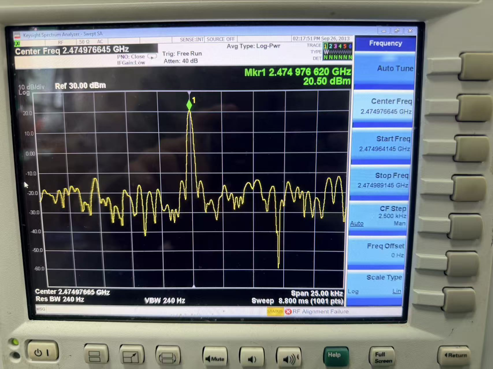

# NF-02-PA (SI24R1) on STM32F103C8T6 + FreeRTOS — Single-Carrier (CW) Test

[](README.zh-CN.md)

> Official documentation: <https://docs.ai-thinker.com/2.4g_1/>

Derived from [`../STM32F103C8T6-FreeRTOS-Demo/`](../STM32F103C8T6-FreeRTOS-Demo/): the packet link is removed and **the board enters a 2475 MHz unmodulated carrier at power-up** (`RF_SETUP = 0x9F`, CE held high) for carrier power, frequency tolerance and spurious measurements. The FreeRTOS heartbeat task is kept to prove the scheduler still runs.

- MCU: STM32F103C8T6, HSE 8 MHz → PLL → 72 MHz
- Project: Keil MDK (**ARM-GNU / arm-none-eabi-gcc** toolchain), `Project.uvprojx`, Device `STM32F103C8`
- Debug UART: USART1 = PA9 (TX) / PA10 (RX), 115200-8-N-1

---

## 1. Layout

```
STM32F103C8T6-FreeRTOS-Single-Carrier/
├── Project.uvprojx          # Keil project (ARM-GNU toolchain)
├── Start/                   # core_cm3, system_stm32f10x, stm32f10x.h
├── gcc/                     # startup_stm32f103xb.s, stm32f103c8.ld, syscalls.c
├── Library/                 # STM32F10x standard peripheral library
├── System/Delay.c/.h        # SysTick based millisecond delay
├── Hardware/
│   ├── LED.c / LED.h        # LED1 = PC13 (on board)
│   └── SI24R1/              # software SPI driver + CW transmission
├── User/main.c              # heartbeat task + single-carrier task
├── FreeRTOS/                # kernel (inc / port / src) + FreeRTOSConfig.h
└── README.md
```

## 2. Pins

| SI24R1 signal | LoraKit silk | STM32F103C8T6 |
|---------------|--------------|---------------|
| CE   | CTR1 | PA11 |
| CSN  | SPI_NSS | PA4 |
| SCK  | SPI_SCK | PA5 |
| MOSI | SPI_MOSI | PA7 |
| MISO | SPI_MISO | PA6 |
| IRQ  | LORA_DIO0 | PB0 |

Wiring is identical to the transceiver project; full port configuration: [`Docs/wiring.md`](../../Docs/wiring.md).

## 3. Carrier parameters

| Item | Value |
|------|-------|
| Channel | `RF_CH_CW = 75` → 2475 MHz |
| `RF_SETUP` | `0x9F` = `CONT_WAVE` + `PLL_LOCK` + 2 Mbps + +7 dBm |
| CE | held high after init, transmitting continuously |
| Address / payload / auto retransmit | unused in CW (macros and address kept for switching back) |

- To change channel or power, edit only `RF_CH_CW` and `RF_SETUP_CW` in `Hardware/SI24R1/SI24R1.h`.
- Occupied bandwidth (OBW) requires **MOD continuous modulated transmission**: clear `EN_AA` / `SETUP_RETR`, hold CE high and keep feeding pseudo-random payloads into the TX FIFO; see [`../AI8051U-Single-Carrier/`](../AI8051U-Single-Carrier/) for an implementation. CW is a single line with an OBW of only tens of kHz.

## 4. Runtime behaviour

- Power-up initialises the LED and USART1, creates two tasks and starts the scheduler.
- **Heartbeat** (128 words, priority 1): toggles LED1 (PC13) every 500 ms.
- **Radio** (256 words, priority 2): `SI24R1_Init()` → `SI24R1_CW_Mode()` → prints the boot banner once → idles; the carrier is output by hardware and does not depend on scheduling.
- UART banner:

```
 STM32F103C8 + FreeRTOS + SI24R1
 CW mode: carrier on, forever
 RF = 2475 MHz, RF_SETUP = 0x9F
 (2Mbps, +7dBm, CONT_WAVE, PLL_LOCK)
```

## 5. Porting notes

1. **Software SPI**: all bit operations use the standard library `GPIO_SetBits` / `GPIO_ResetBits` / `GPIO_ReadInputDataBit` with a 1 us half-period delay (about 500 kHz–1 MHz, far below the 10 MHz limit).
2. **SysTick left alone**: SPI and `PWR_UP` delays use the **DWT cycle counter** (`CoreDebug->DEMCR` / `DWT->CYCCNT`), leaving SysTick for the 1 kHz FreeRTOS tick.
3. **Clock**: `system_stm32f10x.c` sets HSE 8 MHz → 72 MHz, consistent with `Delay.c` and `FreeRTOSConfig.h` (`configCPU_CLOCK_HZ = 72000000`); boards running on HSI without a crystal need all three changed together.
4. **Vector table**: `SVC_Handler` / `PendSV_Handler` / `SysTick_Handler` are redirected to `vPortSVCHandler` / `xPortPendSVHandler` / `xPortSysTickHandler` via `FreeRTOSConfig.h`, matching the table in `gcc/startup_stm32f103xb.s`; do **not** implement them again in `stm32f10x_it.c`.
5. **`configCHECK_HANDLER_INSTALLATION = 0`**: this firmware has not been regression-tested on hardware, so `configASSERT()` and the interrupt-priority assertions stay off; set it to 1 and define `configASSERT()` for a runtime self-check.
6. The FreeRTOS heap is `12 * 1024` (17 KB in the transceiver project); the two tasks need far less.

## 6. Build and flash

1. Install `Keil.STM32F1xx_DFP` and configure the **ARM-GNU (arm-none-eabi-gcc)** toolchain in Keil, then open `Project.uvprojx`.
2. Check the target options: Device = `STM32F103C8`; C/C++ → Define includes `STM32F10X_MD,USE_STDPERIPH_DRIVER`; startup file `gcc/startup_stm32f103xb.s`, linker script `gcc/stm32f103c8.ld` (`gcc/syscalls.c` provides the newlib stubs).
3. Rebuild; **Create HEX File** is enabled, producing `Project.axf` and `Project.hex`.
4. Download with ST-Link, reset, check the UART banner, then connect the board/antenna to a spectrum analyser.

## 7. Spectrum measurement (narrow-span sweep)

Keysight swept spectrum analyser, Ref 30 dBm / 10 dB/div / 40 dB attenuation, centre 2.47498 GHz, span 25 kHz, RBW = VBW = 240 Hz, marker `Mkr1 2.474976620 GHz` reads **20.50 dBm**.



- Only one line within the 25 kHz span, as expected for CW; the occupied bandwidth is just tens of kHz, so this image **cannot** be used to claim OBW.
- The status bar shows an `RF Alignment Failure` warning, meaning the instrument has not completed RF calibration; 20.50 dBm is only qualitative, run Auto Align before a formal power measurement.
- The frequency reading 2.47497662 GHz differs from the 2475 MHz setting by about 23 kHz, within module crystal tolerance; note the measured value in the certification report.

## 8. Notes

- Once the carrier is on, the board ignores keys and sends no packets; just power down when finished.
- The full transceiver description is in [`../STM32F103C8T6-FreeRTOS-Demo/README.md`](../STM32F103C8T6-FreeRTOS-Demo/README.md).
