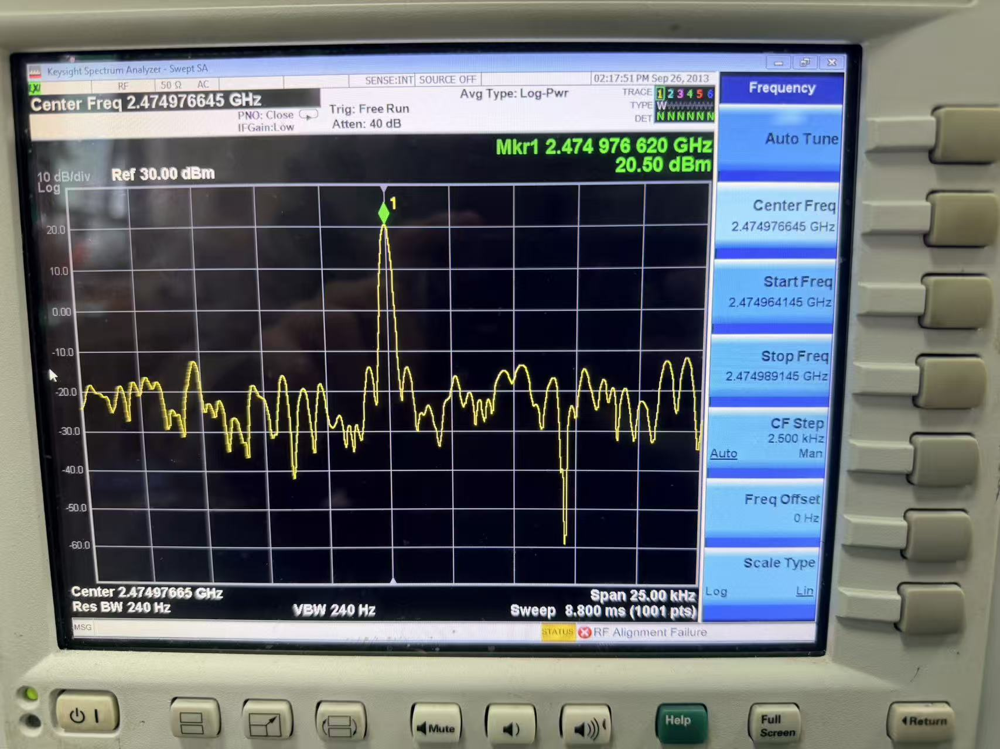

# NF-02-PA(SI24R1) on STM32F103C8T6 + FreeRTOS —— 单载波（CW）测试

[](README.md)

> 官方文档：<https://docs.ai-thinker.com/2.4g_1/>

从 [`../STM32F103C8T6-FreeRTOS-Demo/`](../STM32F103C8T6-FreeRTOS-Demo/) 复制改造：去掉收发链路，**上电即进入 2475 MHz 未调制载波**（`RF_SETUP = 0x9F`，CE 常高），用于载波功率 / 频率容限 / 杂散测试；FreeRTOS 心跳任务保留，用来证明调度器正常。

- MCU：STM32F103C8T6，HSE 8 MHz → PLL → 72 MHz
- 工程：Keil MDK（**ARM-GNU / arm-none-eabi-gcc** 工具链），`Project.uvprojx`，Device `STM32F103C8`
- 调试串口：USART1 = PA9(TX) / PA10(RX)，115200-8-N-1

---

## 1. 目录结构

```
STM32F103C8T6-FreeRTOS-Single-Carrier/
├── Project.uvprojx          # Keil 工程（ARM-GNU 工具链）
├── Start/                   # core_cm3、system_stm32f10x、stm32f10x.h
├── gcc/                     # startup_stm32f103xb.s、stm32f103c8.ld、syscalls.c
├── Library/                 # STM32F10x 标准外设库
├── System/Delay.c/.h        # SysTick 延时（ms 级）
├── Hardware/
│   ├── LED.c / LED.h        # LED1 = PC13（板载）
│   └── SI24R1/              # 软件 SPI 驱动 + CW 发射
├── User/main.c              # 心跳任务 + 单载波任务
├── FreeRTOS/                # 内核（inc / port / src）+ FreeRTOSConfig.h
└── README.md
```

## 2. 引脚

| SI24R1 信号 | LoraKit 丝印 | STM32F103C8T6 |
|-------------|--------------|---------------|
| CE   | CTR1 | PA11 |
| CSN  | SPI_NSS | PA4 |
| SCK  | SPI_SCK | PA5 |
| MOSI | SPI_MOSI | PA7 |
| MISO | SPI_MISO | PA6 |
| IRQ  | LORA_DIO0 | PB0 |

与收发工程接线完全相同，完整端口配置见仓库根目录 [`Docs/wiring.zh-CN.md`](../../Docs/wiring.zh-CN.md)。

## 3. 载波参数

| 项目 | 值 |
|------|-----|
| 信道 | `RF_CH_CW = 75` → 2475 MHz |
| `RF_SETUP` | `0x9F` = `CONT_WAVE` + `PLL_LOCK` + 2 Mbps + +7 dBm |
| CE | 初始化后常高，持续发射 |
| 地址 / Payload / 自动重发 | CW 模式不使用（宏与地址仍保留，便于改回收发） |

- 改信道或功率：只改 `Hardware/SI24R1/SI24R1.h` 的 `RF_CH_CW`、`RF_SETUP_CW`。
- 要测占用带宽（OBW）必须做 **MOD 连续调制发射**：清 `EN_AA` / `SETUP_RETR`，CE 常高并持续向 TX FIFO 喂伪随机载荷，参考 [`../AI8051U-Single-Carrier/`](../AI8051U-Single-Carrier/) 的实现。CW 只有单根谱线，OBW 仅几十 kHz。

## 4. 运行行为

- 上电初始化 LED 与 USART1，创建两个任务后启动调度器。
- **Heartbeat**（128 words，优先级 1）：每 500 ms 翻转 LED1(PC13)。
- **Radio**（256 words，优先级 2）：`SI24R1_Init()` → `SI24R1_CW_Mode()` → 打印一次启动横幅 → 空转；载波由硬件持续输出，与任务调度无关。
- 串口横幅：

```
 STM32F103C8 + FreeRTOS + SI24R1
 CW mode: carrier on, forever
 RF = 2475 MHz, RF_SETUP = 0x9F
 (2Mbps, +7dBm, CONT_WAVE, PLL_LOCK)
```

## 5. 移植要点

1. **软件 SPI**：全部用标准外设库的 `GPIO_SetBits` / `GPIO_ResetBits` / `GPIO_ReadInputDataBit` 位操作，半周期加 1 us 延时（约 500 kHz～1 MHz，远低于 10 MHz 上限）。
2. **不占用 SysTick**：SPI 与 `PWR_UP` 等待延时用 **DWT 周期计数器**（`CoreDebug->DEMCR` / `DWT->CYCCNT`），SysTick 留给 FreeRTOS 的 1 kHz 节拍。
3. **时钟**：`system_stm32f10x.c` 配置 HSE 8 MHz → 72 MHz，与 `Delay.c`、`FreeRTOSConfig.h`（`configCPU_CLOCK_HZ = 72000000`）一致；纯 HSI 无晶振的板子需要同步修改这三处。
4. **向量表**：`SVC_Handler` / `PendSV_Handler` / `SysTick_Handler` 通过 `FreeRTOSConfig.h` 重定向到 `vPortSVCHandler` / `xPortPendSVHandler` / `xPortSysTickHandler`，与 `gcc/startup_stm32f103xb.s` 的向量表一致，**不要**再在 `stm32f10x_it.c` 里重复实现。
5. **`configCHECK_HANDLER_INSTALLATION = 0`**：本固件尚未在硬件上回归，避免连带启用 `configASSERT()` 与中断优先级断言；如需运行期自检，改成 1 并同时定义 `configASSERT()`。
6. FreeRTOS 堆为 `12 * 1024`（收发工程为 17 KB），当前两个任务的栈需求远小于此。

## 6. 编译与烧录

1. Keil 中安装 `Keil.STM32F1xx_DFP`，并配置好 **ARM-GNU（arm-none-eabi-gcc）** 工具链后打开 `Project.uvprojx`。
2. Target 选项核对：Device = `STM32F103C8`；C/C++ → Define 含 `STM32F10X_MD,USE_STDPERIPH_DRIVER`；启动文件为 `gcc/startup_stm32f103xb.s`，链接脚本为 `gcc/stm32f103c8.ld`（`gcc/syscalls.c` 提供 newlib 桩函数）。
3. Rebuild；已勾选 **Create HEX File**，产物为 `Project.axf` 与 `Project.hex`。
4. ST-Link 下载，复位后先看串口横幅，再把板子/天线接频谱仪测载波。

## 7. 频谱实测（窄带扫频）

Keysight 扫频式频谱仪，Ref 30 dBm / 10 dB/div / 衰减 40 dB，中心 2.47498 GHz、Span 25 kHz、RBW = VBW = 240 Hz，标记 `Mkr1 2.474976620 GHz` 读数 **20.50 dBm**。



- 25 kHz 窄带内只有一根谱线，符合 CW 单载波预期；占用带宽只有几十 kHz，**不能**用这张图去论证 OBW。
- 状态栏有 `RF Alignment Failure` 告警，说明仪器未完成 RF 校准，20.50 dBm 只能当定性参考，正式测功率前先跑 Auto Align。
- 频率读数 2.47497662 GHz 与设定的 2475 MHz 相差约 23 kHz，属于模块晶振误差范围，认证测试需在报告中注明实测值。

## 8. 备注

- 载波开启后不再响应按键，也不会发任何数据包；测完断电即可。
- 收发链路的完整说明见 [`../STM32F103C8T6-FreeRTOS-Demo/README.md`](../STM32F103C8T6-FreeRTOS-Demo/README.md)。
