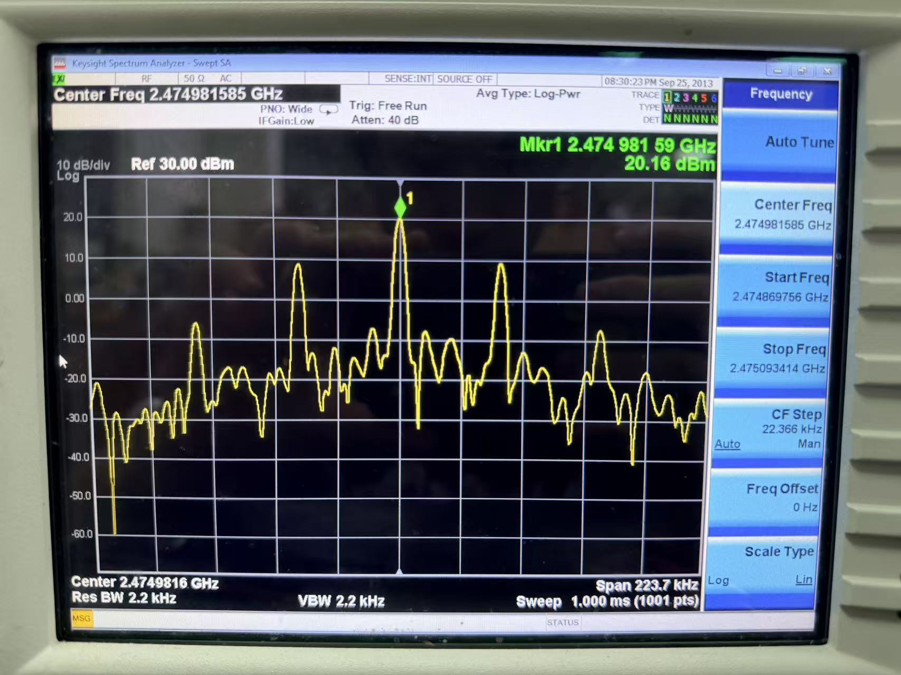

# NF-02-PA(SI24R1) on AI8051U —— 单载波 / 连续调制测试

把 STC15 版单载波测试框架移植到 AI8051U，用 `SI24R1_TEST_MODE` 在“正常链路 / CW / MOD”之间切换。

- 芯片：SI24R1（软件 SPI，nRF24L01+ 兼容）
- MCU：AI8051U，32 位模式（C351），主频 **33.1776 MHz**，UART1 115200-8-N-1

---

## 1. 目录结构

```
ai8051u-single-carrier/
├── Source/
│   ├── main.c                # 模式分支入口（CW / MOD / 正常链路）
│   ├── main_full.c           # 完整参考版，未加入工程编译
│   ├── SI24R1.c / SI24R1.h   # 驱动 + 引脚 + SI24R1_TEST_MODE
│   └── XSFR_STC8051U_8Bit.H  # AI8051U 寄存器/端口定义
├── Toolchain/                # 本地 Keil C51 工具链缓存（CI 不含二进制）
├── AI8051U-SI24R1.uvproj     # Keil C51 工程
├── build.bat                 # 命令行编译脚本
├── keilkill.bat              # 清理编译中间文件
└── README.md
```

## 2. 测试模式

`Source/SI24R1.h` 中 `SI24R1_TEST_MODE` **当前默认 1（CW）**：

```c
#define SI24R1_TEST_MODE  1   // 0 = 正常收发链路
                              // 1 = CW  未调制单载波（当前默认）
                              // 2 = MOD 连续调制发射
```

| 模式 | 参数 | 用途 |
|------|------|------|
| 0 | `RF_CH = 100` / 2500 MHz，1 Mbps，+7 dBm（`0x07`） | 正常收发链路，行为同 `ai8051u-demo` |
| 1 | `RF_CH = 75` / 2475 MHz，2 Mbps，+7 dBm，`RF_SETUP = 0x9F` | 载波功率、频率容限、杂散 |
| 2 | 同上信道/速率，`RF_SETUP = 0x0F`，清自动应答、持续喂 TX FIFO | 占用带宽、6 dB 带宽、PSD |

- 文件头注释里写的“0 为默认”是原始说明，实际宏值以 `#define SI24R1_TEST_MODE` 一行为准，出载波前请确认。
- 测 OBW 必须用模式 2：逐包发送是通断突发，扫频式频谱仪测不准。

## 3. 引脚

| SI24R1 信号 | AI8051U |
|-------------|---------|
| CE   | P1.4 |
| CSN  | P1.5 |
| SCK  | P1.2 |
| MOSI | P1.3 |
| MISO | P1.0 |
| IRQ  | P1.1 |

- 调试串口：P3.7（TX）/ P3.6（RX），115200-8-N-1。
- 状态 LED：`P2^0`（低电平点亮）。
- 角色宏 `SI24R1_ROLE` 默认 **TX**，仅模式 0 下有效；两块板需一收一发。

## 4. 编译与烧录

1. 改好 `SI24R1_TEST_MODE`。
2. 双击 `build.bat`（产物 `Objects/AI8051U-SI24R1.Hex`），或用 Keil C51 打开 `AI8051U-SI24R1.uvproj` 编译。
3. STC-ISP 下载，AI8051U 按提示冷启动。
4. 模式 1/2 上电即发射，测完改回 0 或断电。

## 5. 频谱实测（窄带扫频）

Keysight 扫频式频谱仪，Ref 30 dBm / 10 dB/div / 衰减 40 dB，中心 2.47498 GHz、Span 223.7 kHz、RBW = VBW = 2.2 kHz（PNO Wide），标记 `Mkr1 2.47498159 GHz` 读数 **20.16 dBm**。



- 除 2475 MHz 主谱线外还有若干离散旁线，说明这次观测到的不是纯单载波；作为 CW 参考前先确认烧进去的固件确实是 `SI24R1_TEST_MODE = 1`。
- 扫频式频谱仪只能定性看窄带谱形；占用带宽（OBW ≥ 500 kHz 判据）必须用模式 2 + 宽 Span 或专门的 OBW 功能测。

## 6. 备注

模式 0 的串口日志与截图见 `../ai8051u-demo/`；两工程引脚、驱动一致，可互相替换烧录。
